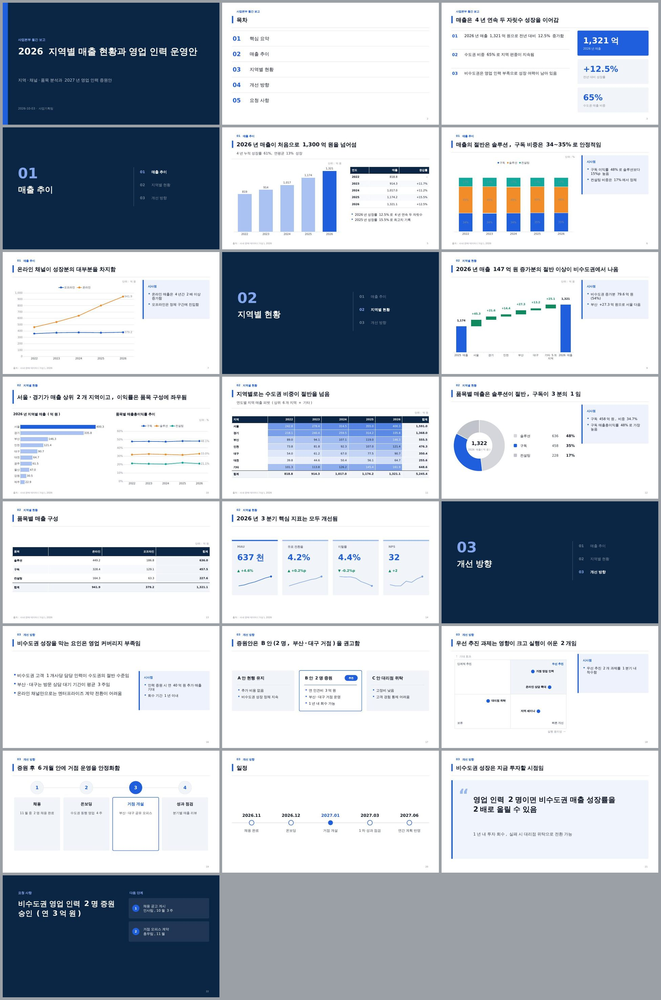

# Awesome-PPT-SKILL

**HTML에서 디자인하고, 눈으로 검수한 뒤, 편집 가능한 PowerPoint로 전달하는 스킬 + CLI(`pptkit`).**

- 새 자료는 HTML/CSS로 구도를 만들고 브라우저에서 확인한 뒤 PPT로 변환합니다. 텍스트·기본 도형·표·지원 차트는 네이티브 객체로 남습니다. 전체 장표 이미지로의 자동 대체는 없습니다.
- 사진·제품 화면은 로컬 원본 에셋으로 사용합니다. 설명·라벨·수치는 별도 편집형 요소로 유지합니다. 반복 보고는 기존 `deck.md` 경로를 계속 사용할 수 있습니다.
- 덱 구성은 지어내지 않습니다. 목적(피칭, 고객 제안, 보고, 기획안, 교육)을 묻고, 검증된 구성안(VC 시드, Sequoia, 트랙션 우선, 데모데이, 정부지원사업 PSST 등)을 보여 주고, 사용자가 고른 구성으로 만듭니다.
- 새 자료에는 **PPTKIT Studio**의 세 방향을 적용합니다. 편집형·제품형·전략형은 색뿐 아니라 타이포 비율·정보 밀도·구도·에셋 사용법이 다릅니다. 실제 HTML 견본 18장과 토큰·서체·차트 도구를 함께 제공합니다. [디자인 시스템](DESIGN.md)
- 서비스·교육 제안은 **이용자가 실제로 받거나 쓰는 것**부터 찾습니다. 안내지·기록지·검토지·실행 조건표의 편집형 예제 3장을 추가로 제공하며, 운영안의 인원·물량·예산·담당을 맞추는 기준도 스킬에 포함합니다.

**[세 방향의 실제 PPT 견본 보기 →](docs/studio.md)**

[같은 씨앗도서관 운영안을 세 양식으로 비교한 사례](docs/studio/field-checks.md)

[추가 디자인 피드백 없이 만든 온보딩 세 컨셉 원샷 결과](docs/evals/onboarding-one-shot-2026-11-18.md)

## 설치 (Windows · macOS · Linux)

```bash
uv tool install "pptkit[html] @ git+https://github.com/coindesktop/Awesome-PPT-SKILL"
pptkit html setup                                                     # Chromium 설치
pptkit install-skill                                                  # ~/.claude/skills/ppt
# Codex: pptkit install-skill --dest ~/.codex/skills/ppt
```

개발용: `git clone` 후 `./scripts/setup.sh` (의존성, `pip install -e .`, 렌더 확인용 LibreOffice·한국어 폰트).

## HTML 우선 제작

```bash
pptkit html designs
pptkit html init deck.html --design editorial  # product / strategy도 선택 가능
# 내용·시각 방향·구도 수정
pptkit html preview deck.html
# 실제 미리보기를 열어 검수
pptkit html build deck.html -o deck.pptx
pptkit html render deck.pptx
# HTML과 PPT 결과 비교 후 전달
```

PPT 렌더는 Windows PowerPoint 또는 다른 OS의 LibreOffice가 필요합니다.
`deck.assets/`에 토큰·CSS·구도 선택 기준·Pretendard·견본 에셋이 복사됩니다.
`deck.assets/components/working-artifacts.html`에는 다른 주제에도 응용할 수 있는 편집형 사용물 예제가 있습니다.
이 파일도 `pptkit html preview`와 `pptkit html build`의 입력으로 사용할 수 있습니다.
`deck.assets/showcase/`에는 씨앗도서관 세 양식의 실제 PPT 미리보기와 출처·가정 기록도 포함됩니다.
PPT를 여는 PC에도 Pretendard를 설치해야 합니다. 글꼴 자동 임베딩은 지원하지 않습니다.
견본의 가상 수치·서비스·생성 비주얼은 실제 내용으로 교체합니다.
HTML 구조 검사는 시각적 품질을 평가하지 않습니다. 실제 렌더 이미지를 확인해야 합니다.
텍스트 보존 결과와 편집형 요소 수는 `deck.editable.json`에 기록됩니다.

배포 스킬에 [Studio 사용법](.claude/skills/ppt/references/studio-system.md), [디자인 방법](.claude/skills/ppt/references/html-first-design.md)과
[지원 HTML 규칙](.claude/skills/ppt/references/html-contract.md)을 포함합니다.
[사용물 중심 에셋](.claude/skills/ppt/references/working-artifacts.md)과 [실행 기획 기준](.claude/skills/ppt/references/practical-proposals.md)은 해당 자료를 만들 때 읽습니다.
v1은 1280×720px, 명시적인 `data-pptx` 요소를 받습니다. 임의 웹페이지의 완전한 변환은 지원하지 않습니다.
로컬 개발은 `uv pip install -e ".[html]"`. HTML 없이 기존 보고 기능만 쓰려면 `[html]` 없이 설치할 수 있습니다.

## 기존 Markdown 보고 제작

Claude Code에서 "이 CSV로 본부장 보고용 PPT 8장 만들어줘"처럼 요청하면 `ppt` 스킬이 아래 순서로 진행합니다.

이 경로는 수치를 반복 갱신하는 기존 `deck.md` 보고용입니다. 기존 9종 테마와 `pptkit design show`는 유지합니다.

| 단계 | 명령 | Claude가 읽는 양 |
|---|---|---|
| 사람 파악 (한 번만) | `pptkit profile` / `pptkit style extract old.pptx` | 한 줄 또는 빈 항목 목록 |
| 목적 → 구성안 선택 | `pptkit plan` → `pptkit plan pitch` → `pptkit plan pitch/vc-seed -o deck.md` | 구성안 목록, 뼈대와 내용 질문 |
| 이번 덱 파악 | `brief.yaml` 작성 → `pptkit tone --brief brief.yaml` | 디자인·문체·규칙 3줄 |
| 데이터 | `pptkit data a.csv b.csv` / `pptkit pivot ... [--bridge 2025,2026]` / `pptkit fetch wb ...` | 파일당 요약 약 100토큰 |
| 덱 문법 | `pptkit spec progress waterfall` | 쓰는 패턴의 키만 |
| 톤 시안 | `pptkit build deck.md --sample` | 한 줄 |
| 생성·점검 | `pptkit build deck.md` (qa 포함, Windows는 `pptkit qa --com`) | 한 줄, 문제만 |
| 기존 덱 수정 | `pptkit map` → `pptkit read -s 3,5` → `pptkit patch deck.pptx ops.yaml` | 장당 한 줄 + 필요한 장만 |

전체 명령: `pptkit -h`. 스킬 문서: [`.claude/skills/ppt/SKILL.md`](.claude/skills/ppt/SKILL.md), 덱 문법: [`deck-spec.md`](.claude/skills/ppt/references/deck-spec.md), 편집 문법: [`editing.md`](.claude/skills/ppt/references/editing.md).

## 들어 있는 것

| 구분 | 내용 |
|---|---|
| 개인화 | Profile(사람) × Brief(이번 덱) → 디자인·문체·밀도·업종 관례. 프로필은 `~/.pptkit/`에 저장되어 다시 묻지 않음 |
| 디자인 | `pptkit/designs/*.md` 9종 + 사용자 DESIGN.md(`~/.pptkit/designs/`), 카드 표현 토큰(채움·외곽선·그림자), `pptkit design show`(토큰 장표가 든 견본), 회사 템플릿 위 렌더링(마스터·로고 유지) |
| 구성안 | `pptkit/storylines.yaml`: 목적 5종 × 구성안 14개, 장표별 내용 질문 |
| 아이콘 | Lucide 선 아이콘 136종을 편집 가능한 벡터 도형으로(`icon: rocket`), 사진 없음 |
| 장표 패턴 | 38종: 피칭(pillars, traction, team, pricing, product-shot, funding-ask) 외 구조(표지·목차·섹션·요약·결론), 메시지, 비교(compare, compare-table, before-after, swot, matrix-2x2, logic-tree), 흐름(process, timeline, roadmap, gantt, funnel), 진척(progress, status-table), 자유 표·이미지(table: 마크다운 표·셀 병합, image), 다단계 글머리, 로고·바닥글 표시, 데이터(chart-takeaway, chart-table, chart-pair, pivot, heatmap, kpi-tiles, big-number, market-size) |
| 차트 | column-trend, line-trend, bar-ranked, stacked, stacked-share, waterfall(증감 요인), donut(구성비) (검증된 팔레트, 단일 강조색, 이중 축 없음) |
| 데이터 | CSV/XLSX, KOSIS 다운로드 형식 자동 정리, 피벗(합계·상위 N+기타·가중 평균) |
| 통계 | World Bank(키 없음), KOSIS(사용자 키, 터미널에서 직접 등록), 캐시와 출처 자동 각주 |
| 반복 보고 | `vars:`로 숫자를 데이터에 연결(`$rev`), `latest`/`prev` 기간 단어: 새 달 데이터를 넣고 다시 빌드하면 제목·KPI·차트가 함께 갱신되고 바뀐 숫자를 알려 줌 |
| 편집 | 아무 .pptx나 map/read/patch: 텍스트·위치·차트 데이터·표·일괄 치환·겹침 정리·노트 |
| 점검 | 겹침·넘침·이탈·잔여 placeholder, Windows에서는 PowerPoint로 글자 높이 실측(`--com`) |

## 예제

[`docs/gallery.md`](docs/gallery.md): 목적·디자인별 예제 10종의 미리보기와 원본(deck.md·CSV·pptx).



## 검증

- 테스트: `python tests/test_pptkit.py`
- HTML 변환·편집성: `python -m pytest tests/test_html_deck.py -q`
- 디자인 전이 평가 시나리오: [`evals/html-first.json`](evals/html-first.json). 같은 대화의 사용자 선호 기록과 독립 평가를 구분합니다.
- 평가: [`evals/evals.json`](evals/evals.json) 5개 시나리오, 채점 [`evals/grade.py`](evals/grade.py), 결과 [`docs/evals/`](docs/evals/)

## 문서

- 기획: [`docs/plan/01-spec.md`](docs/plan/01-spec.md), [장표 패턴](docs/plan/02-slide-patterns.md), [통계 연결](docs/plan/03-data-sources.md), [개인화](docs/plan/04-personalization.md)
- 조사: [`docs/research/landscape.md`](docs/research/landscape.md), 레퍼런스: [`references/`](references/README.md)

## 저장소 구성

```
pptkit/                CLI (render, patterns_p1, edit, qa, data, persona, style, sources) + designs/ + catalog.yaml
.claude/skills/ppt/    배포되는 스킬 (pptkit install-skill 이 복사)
examples/              예제 덱 12종: 보고(매출·월간·분기 검토·마케팅·인사·프로젝트), 제안(신사업·고객), 피칭(VC·PSST), 교육, 패턴 모음
evals/                 평가 시나리오, 가상 데이터, 채점기
references/            참고한 MIT 스킬·DESIGN.md 원본 (비활성)
.claude/skills/        개발 세션용 스킬들 (ppt 외에는 개발 보조용)
```
