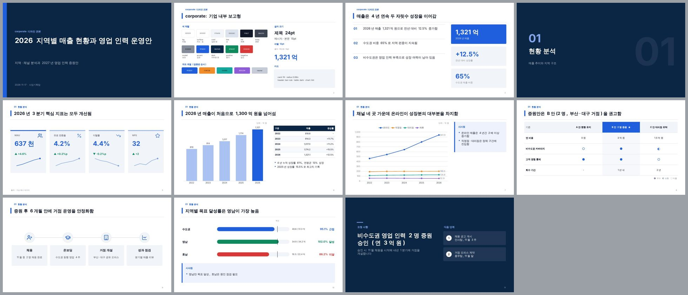
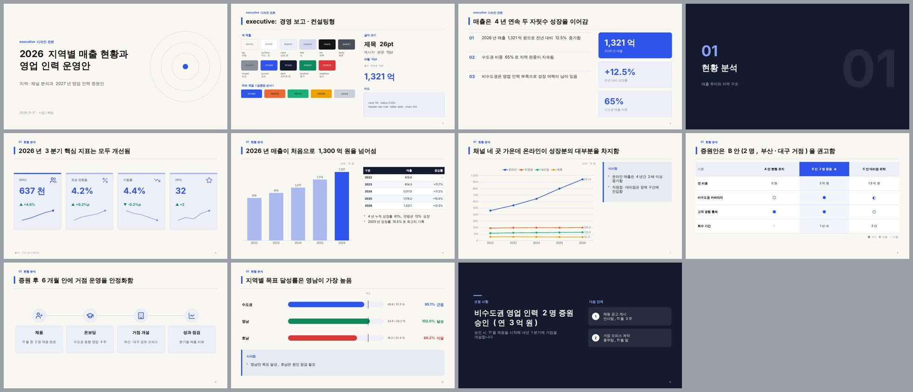
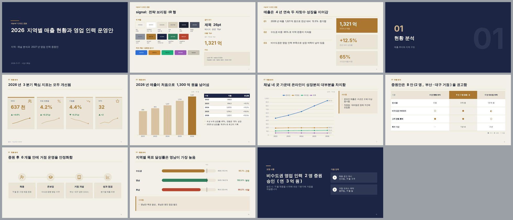
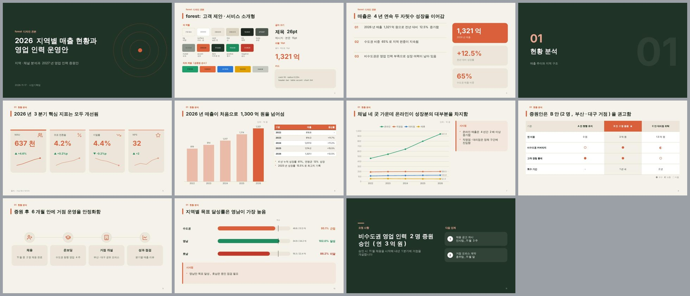
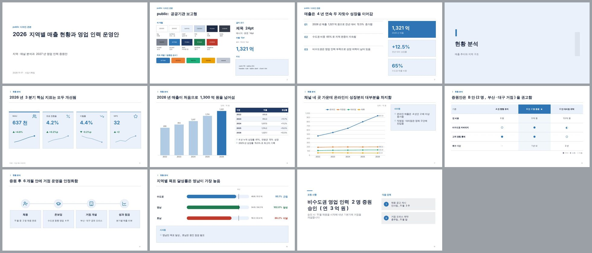
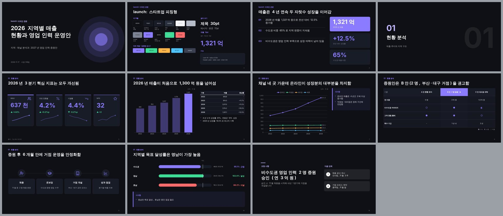
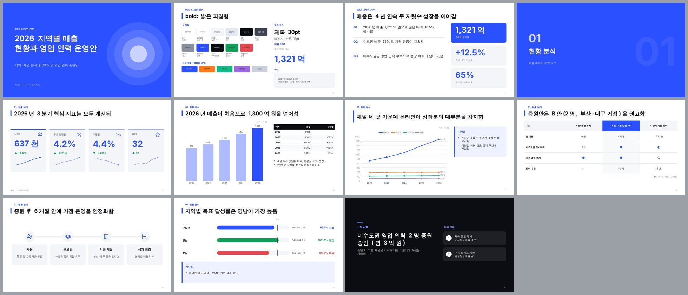
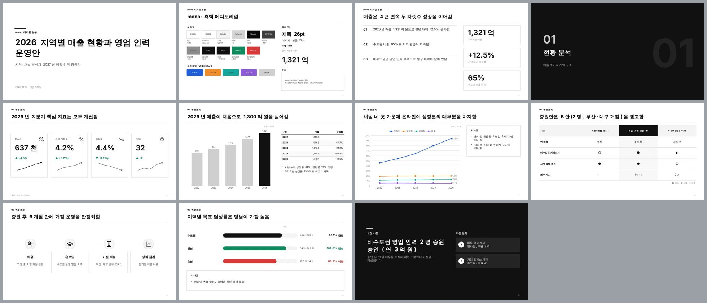
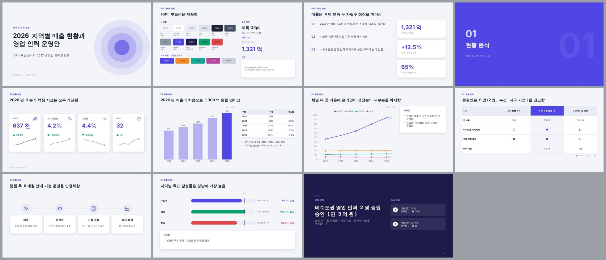

# 디자인 시스템

디자인 하나는 `pptkit/designs/<이름>.md` 파일 하나다. 앞부분(front matter)의 토큰이 모든 장표 패턴에 적용되고,
본문은 그 디자인의 의도와 금지 사항을 적은 설명이다. `pptkit design`이 목록을, `pptkit design show <이름>`이
견본 덱(토큰 장표 + 주요 구성요소 10장)을 만든다. 아래 이미지는 모두 그 견본이다.

| 디자인 | 성격 | 카드 | 어울리는 곳 |
|---|---|---|---|
| `corporate` | 흰 바탕, 남색 표지·표 머리, 파랑 강조, 제목 옆 강조 막대 | 채움 | 기업 내부 보고(기본값) |
| `executive` | 웜 그레이 바탕, 한 가지 강조색, 조용한 컨설팅형 | 채움 | 경영 보고, 컨설팅 |
| `signal` | 짙은 남색 표지와 금색 강조 | 채움 | 전략 브리핑, IR |
| `forest` | 숲색 표지, 주황 강조, 둥근 카드 | 채움 | 고객 제안, 서비스 소개 |
| `public` | 남색 머리, 로마 숫자 섹션, 공공 보고 관례 | 채움 | 공공기관 보고 |
| `launch` | 전 장 어두운 바탕, 보라 강조, 큰 숫자 | 채움 | 투자 피칭 |
| `bold` | 흰 바탕, 큰 제목, 선명한 파랑 표지 | 채움 | 밝은 피칭, 데모데이 |
| `mono` | 흑백 에디토리얼. 색 없이 크기·굵기·선으로 위계 | 외곽선 | 전략 문서, 인쇄용 보고 |
| `soft` | 옅은 회색 바탕 위 흰 카드와 그림자, 인디고 강조 | 그림자 | 제품 소개, 교육, 가벼운 보고 |

## 토큰

```yaml
colors:            # 역할별 색 (6자리 hex, # 없이)
  bg: "F3F5F9"       # 본문 장표 바탕
  surface: "FFFFFF"  # 카드·표 바탕 (생략하면 흰색)
  card: "E9ECF5"     # 한 단계 낮은 면: 표 머리, 진척 막대의 빈 구간
  line: "DFE3EC"     # 선, 카드 외곽선
  ink / body / muted # 제목 / 본문 / 보조 글자
  accent: "4F46E5"   # 단 하나의 강조색
  dark: "1E1B4B"     # 어두운 장표(표지·섹션·결론) 바탕
  positive / negative / neutral_series
series: [...]      # 여러 계열 차트의 색 순서. 색각 이상 검증을 통과한 조합만 쓴다
type: {cover, title, eyebrow, message, body, metric, small}   # 글자 크기(pt)
shape:
  radius: 0.16       # 모서리(in). 0이면 직각
  border_pt: 0       # 카드 외곽선 두께
  card: elevated     # fill(옅은 채움, 기본) | outline(외곽선만) | elevated(흰 카드 + 그림자)
  shadow: {blur: 18, dist: 5, alpha: 10}   # elevated일 때 그림자(pt, pt, %)
cover: {bg: light|dark|accent, decor: none|rule|stripe|circles|orb}
section / closing: dark | light | tint | accent
style:
  header: plain | bar | rule | bar-rule
  chart: neutral | tint          # 단일 계열에서 강조 외 막대: 회색 | 강조색의 옅은 단계
  table_head: card | dark | accent | plain
  callout: card | tint
  kpi: plain | strip
```

구성요소는 토큰만 읽는다. 카드(`KPI 타일`, `요약 숫자`, `프로세스 단계`, `시사점`, `요금제`, `팀`)는 모두
`shape.card` 하나로 모양이 바뀌고, 표는 PowerPoint 기본 표 스타일을 쓰지 않고 `line` 색의 행 구분선만 그려서
어두운 디자인에서도 흰 격자가 생기지 않는다.

## 내 디자인 만들기

1. `pptkit/designs/corporate.md`를 `~/.pptkit/designs/<이름>.md`로 복사해 토큰을 바꾼다. 빠진 토큰이나 잘못된
   값이 있으면 `pptkit`이 토큰 이름을 알려 준다.
2. `pptkit design show <이름>`으로 견본을 만들어 확인한다. 2번째 장이 토큰 장표다.
3. `series`를 바꿨다면 색각 이상 구분 검증을 통과하는지 확인한다(인접 쌍 ΔE 8 이상).
4. 기존 덱에서 뽑으려면 `pptkit style extract old.pptx`를 쓴다.

## 견본

### corporate


### executive


### signal


### forest


### public


### launch


### bold


### mono


### soft

