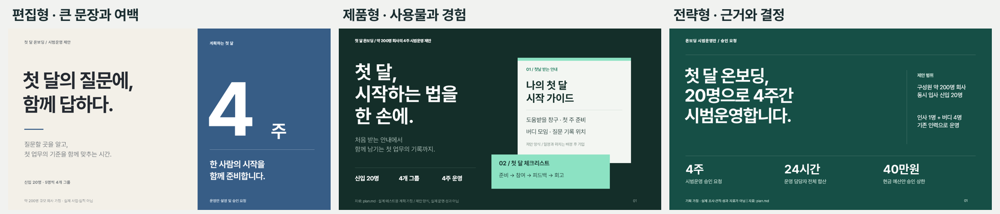
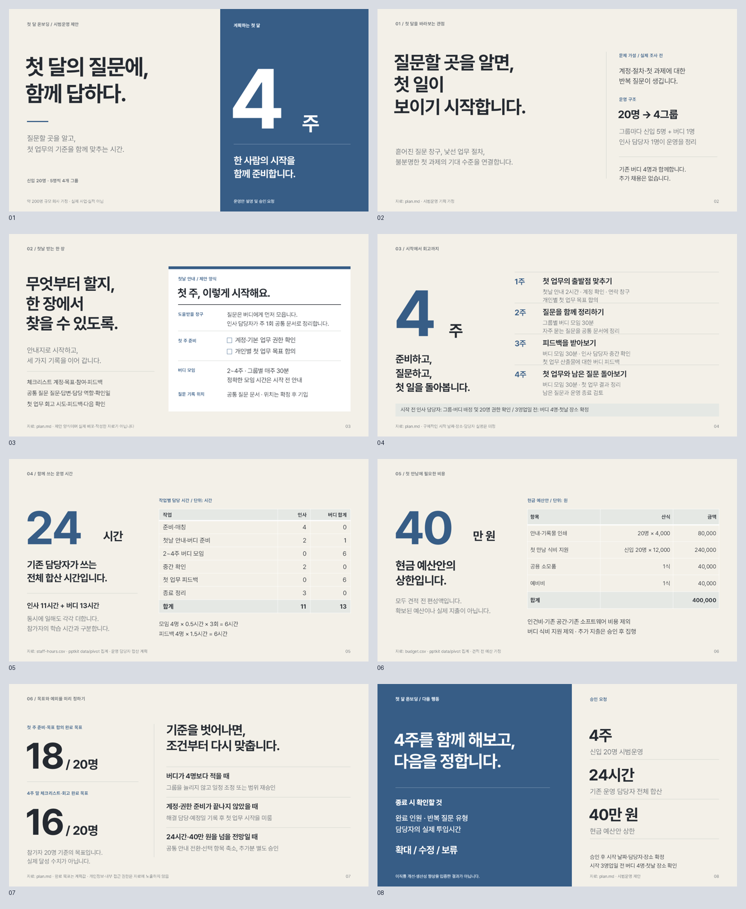
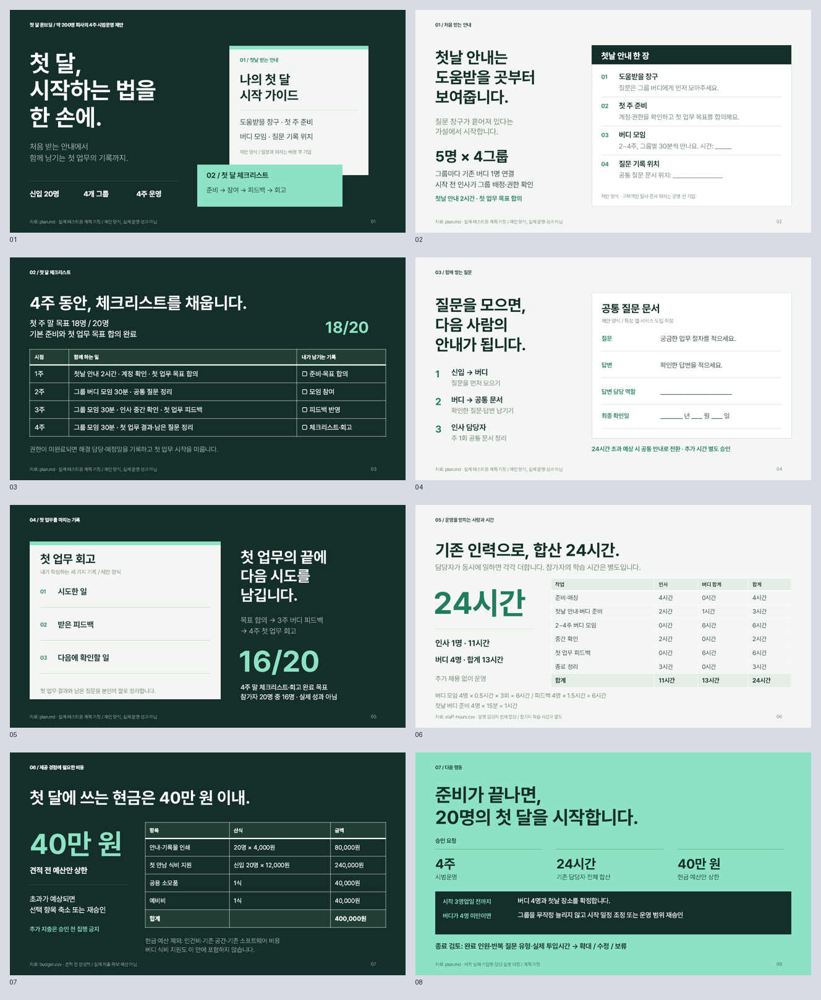
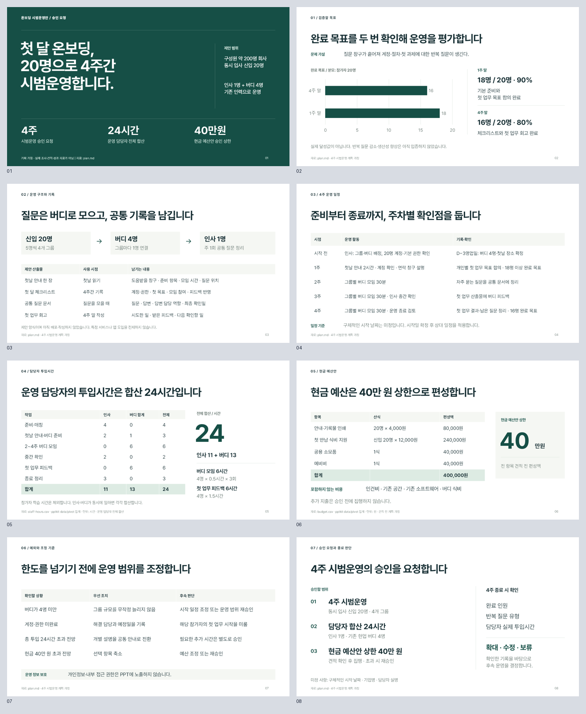
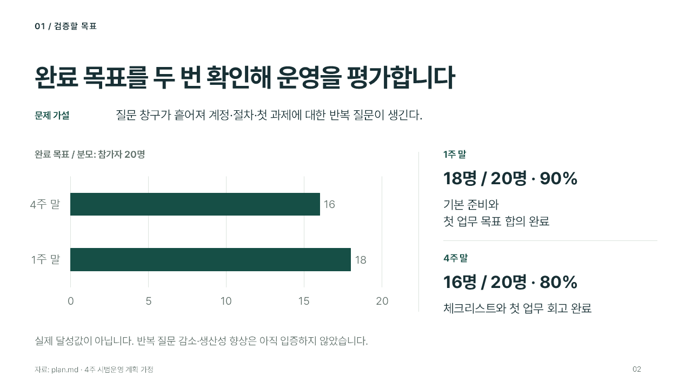
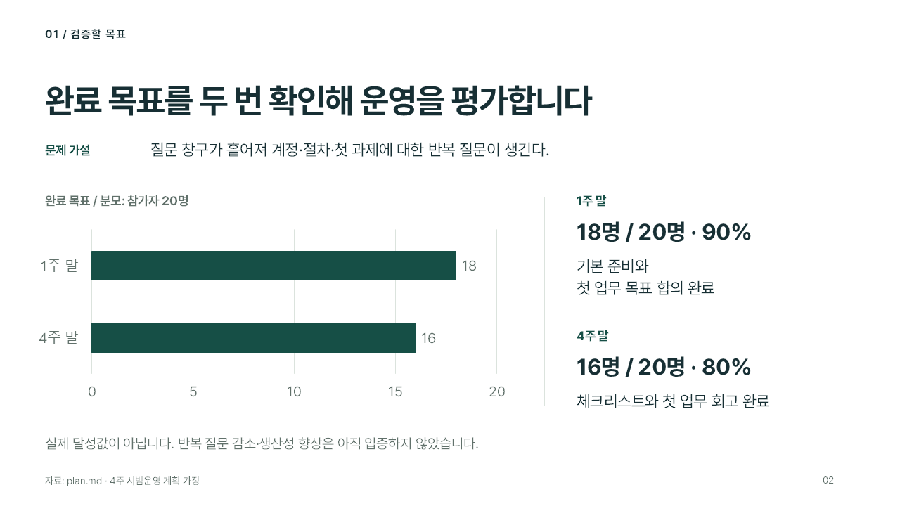

# 같은 기획안으로 세 컨셉 원샷 테스트

**신입 20명의 첫 달 온보딩 기획안**을 동일하게 주고 editorial·product·strategy를 각각 한 번 요청했다.
세 실행은 이전 디자인 대화 없이 독립적으로 시작했다. 추가 사용자 질문과 디자인 피드백은 없었다.
사용한 스킬은 [160f153](https://github.com/coindesktop/Awesome-PPT-SKILL/commit/160f153db9804c09394c2ff960a269dab41877b1)이다.

## 결과

| 컨셉 | 원샷 PPT | 실제 표현 | 실행 내부의 수정 |
|---|---|---|---|
| editorial | [8장 다운로드](onboarding-one-shot-2026-11-18/editorial-original.pptx) | 큰 문장·여백·첫날 안내지 확대 | 대표 장표에서 큰 숫자 높이 1회, 전체본에서 표 아래 간격 1회 |
| product | [8장 다운로드](onboarding-one-shot-2026-11-18/product-original.pptx) | 안내지·체크리스트·질문 문서·회고지를 사용하는 과정 | 일정 조건의 표현 1회, 레이아웃 수정 없음 |
| strategy | [8장 원샷 원본](onboarding-one-shot-2026-11-18/strategy-original.pptx) · [변환기 수정 후 재출력](onboarding-one-shot-2026-11-18/strategy-fixed.pptx) | 수치·역할·일정·예산·예외 조건의 비교 | 표 아래 간격과 텍스트 높이 2회. 부모 검수에서 차트 순서 차이 추가 발견 |

여기서 원샷은 **사용자 요청 1회, 후속 디자인 피드백 0회**다. 스킬이 요구하는 자체 검수·수정은 포함한다.
코드 작성이나 파일 빌드가 단 한 번이었다는 뜻은 아니다. 최초 전체 HTML과 최초 성공 PPT는 별도로 보존했다.
평가자가 원샷 결과의 디자인을 수정하지 않았다.

## 관찰

- 제품형은 이용자가 무엇을 받고 어떻게 사용하는지가 가장 구체적으로 드러났다. 가짜 앱 화면 없이 문서 양식으로 서비스를 표현했다.
- 편집형은 읽는 순서와 여백이 명확하다. 5·6장의 큰 수치와 표 구도가 연속되어 다소 반복된다.
- 전략형은 승인에 필요한 조건을 비교하기 좋다. 3~7장이 표 중심이어서 세 결과 중 구도 변화가 가장 적다.
- 세 결과 모두 외부 이미지나 생성 이미지를 사용하지 않았다. 사진·생성 에셋의 자동 선택 품질은 이번 시험에서 검증하지 않았다.

### Editorial

### Product

### Strategy — 평가 원본

## 확인한 내용과 편집성

기획안의 20명·4주·운영 담당자 합산 24시간·현금 예산안 40만 원을 세 덱 모두 유지했다.
native 표에서 비용 항목과 인사 11시간·버디 13시간을 추출해 CSV와 대조했다.
18/20명·16/20명은 실제 실적이 아닌 완료 목표로 표시했다. 예외 조치와 미정 사항도 유지했다.

| 컨셉 | 편집형 텍스트 | 도형 | 표 | 차트 | 이미지 |
|---|---:|---:|---:|---:|---:|
| editorial | 110 | 29 | 2 | 0 | 0 |
| product | 120 | 26 | 3 | 0 | 0 |
| strategy | 94 | 14 | 5 | 1 | 0 |

임시 사본에서 제목과 표 셀을 실제 수정·재저장했다. 전략형 차트는 값 수정과 embedded workbook도 확인했다.
세 원샷 PPT 모두 PowerPoint 렌더와 COM 글자 높이 검사를 통과했다. 하지만 아래 차트 표현 문제는 자동 검사로 잡히지 않았다.

## 발견한 문제와 후속 수정

**가로 막대차트의 범주 순서:** HTML은 1주 말 → 4주 말인데 PowerPoint 기본값은 반대로 표시했다.
데이터 값 자체는 정확했지만 오른쪽 설명과 시각적 행 순서가 어긋났다. 전략형의 원샷 결과는 이 항목을 미통과로 기록했다.

변환기에서 범주 표시 방향을 맞추고 숫자축은 아래에 유지했다. 데이터와 워크북의 원래 순서는 바꾸지 않았다.
같은 HTML을 다시 변환한 별도 파일에서 아래 결과를 확인했다. 평가 원본을 수정본으로 덮어쓰지 않았다.

bar·column·line의 데이터 순서와 직렬화된 축 설정을 확인하는 회귀 검사를 추가했고 HTML 테스트 17개가 통과했다.
수정본의 PowerPoint 렌더와 COM 검사도 통과했다.

**brief 입력 오류:** 세 실행 모두 `tone`에 자유 문체를 넣어 처음에 CLI 오류를 냈다가 자체 복구했다.
스킬에 `mode`, `formality`, `studio_design`, `writing_style`을 사용하는 최소 예제를 추가했다.
이 문서 수정으로 다음 독립 실행의 오류가 사라지는지는 아직 재평가하지 않았다.

## 입력과 평가 범위

- [공통 기획안](../../evals/data/onboarding-plan.md), [예산 CSV](../../evals/data/onboarding-budget.csv), [시간 CSV](../../evals/data/onboarding-staff-hours.csv)
- [정확한 요청·입력 해시·실행 규칙](../../evals/one-shot-2026-11-18.json)
- [원샷 검수 결과](onboarding-one-shot-2026-11-18/benchmark.json)

기획안은 테스트용 계획 가정이며 특정 회사의 실제 사업·성과가 아니다.
대조군 없이 한 주제·컨셉당 1회만 실행했다. 따라서 미적 품질의 일반화, 사용자 성공률, 구버전 대비 개선율을 주장하지 않는다.
정량 항목은 내용·편집·검수 조건이며 디자인 점수가 아니다. 모델의 정확한 버전·토큰·소요시간은 도구가 노출하지 않아 기록하지 않았다.
