# 예제 갤러리

모든 예제는 가상 데이터로 만들었고, 숫자는 `pptkit pivot`/`data`로 뽑았다. 각 폴더의 `deck.md`가 원본이고
`pptkit build deck.md`로 같은 덱이 다시 나온다(`deck.pptx`도 함께 있다).

| 예제 | 내용 | 구성안 | 디자인 | 장수 |
|---|---|---|---|---|
| [sales-report](../examples/sales-report/deck.md) | 지역별 매출 현황과 영업 인력 증원안 (본부장 보고) | 결론 먼저 보고 | corporate | 22 |
| [marketing-report](../examples/marketing-report/deck.md) | 3분기 디지털 마케팅 캠페인 성과, 4분기 예산 재배분 | report/exec-report | corporate | 10 |
| [hr-report](../examples/hr-report/deck.md) | 상반기 인력 현황과 하반기 채용·리텐션 계획 | report/exec-report | executive | 11 |
| [monthly-report](../examples/monthly-report/deck.md) | 영업 실적 월간 보고: 숫자를 `vars`로 연결해 새 달 데이터만 넣으면 갱신 | - | corporate | 6 |
| [quarterly-review](../examples/quarterly-review/deck.md) | 분기 실적 검토: 병합 머리글이 있는 손익표, 파일에서 읽은 표, 다단계 글머리, 이미지, 로고·대외비 표시 | - | corporate | 6 |
| [project-status](../examples/project-status/deck.md) | ERP 고도화 프로젝트 9월 진척, 지연 원인과 대안 | report/scr | signal | 11 |
| [newbiz-proposal](../examples/newbiz-proposal/deck.md) | B2B 구독형 설비 예지정비 신사업 제안 | proposal/new-biz | corporate | 10 |
| [sales-proposal](../examples/sales-proposal/deck.md) | 물류센터 WMS 도입 제안 (고객사용) | sales/problem-led | bold | 9 |
| [gov-psst](../examples/gov-psst/deck.md) | 예비창업패키지 발표평가 (PSST) | pitch/gov-psst | public | 11 |
| [pitch](../examples/pitch/deck.md) | 시드 투자 피치덱 | pitch/vc-seed | launch | 10 |
| [onboarding-education](../examples/onboarding-education/deck.md) | 신입사원 데이터 리터러시 강의 | education/lecture | forest | 12 |
| [p1-patterns](../examples/p1-patterns/deck.md) | 비교·흐름 패턴 모음 | - | forest | 12 |

## 미리보기

### sales-report
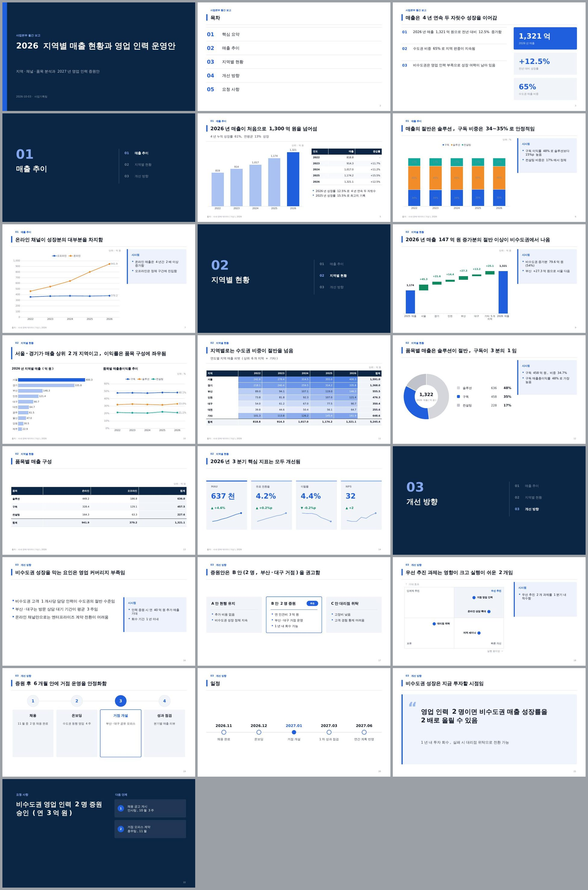

### marketing-report
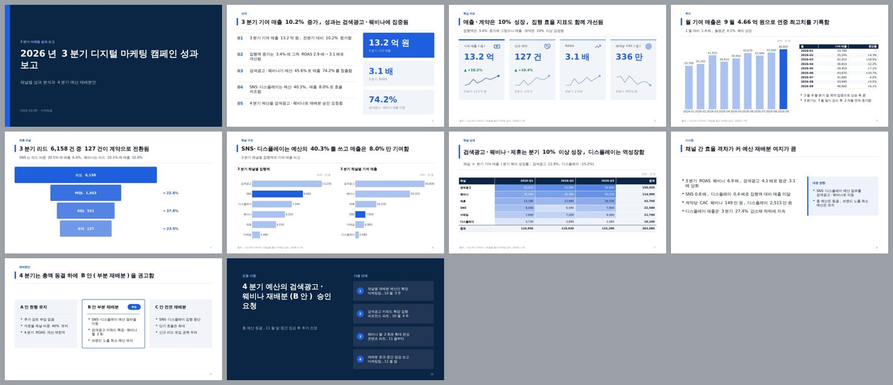

### hr-report
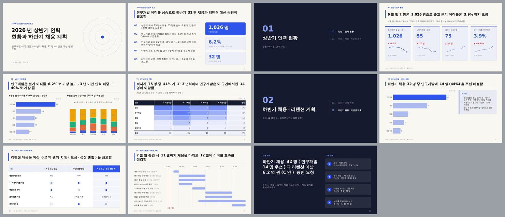

### monthly-report
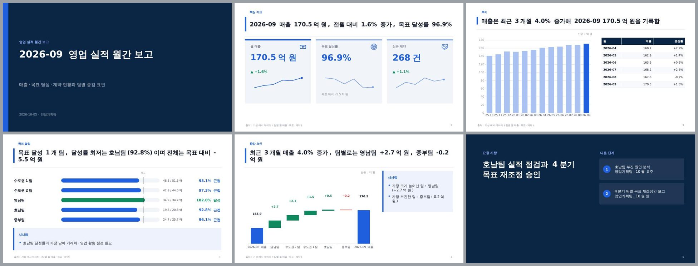

`monthly.csv`에 2026-10 행을 추가하고 `pptkit build deck.md`를 다시 실행하면 제목·KPI·차트·워터폴이 10월 기준으로
바뀌고, 빌드가 바뀐 숫자와 그 숫자를 쓴 장표를 알려 준다(`VARS $mom +1.6% -> -10.0% ... SIGN FLIPPED`).

### quarterly-review
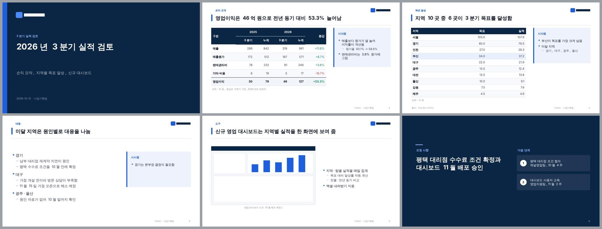

### project-status
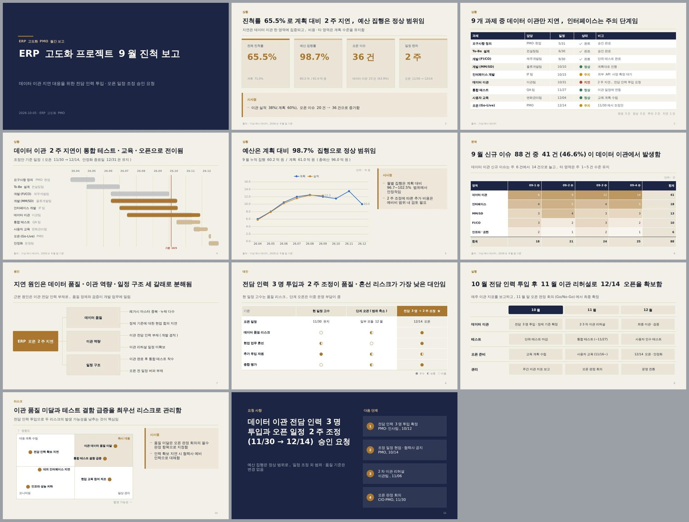

### newbiz-proposal
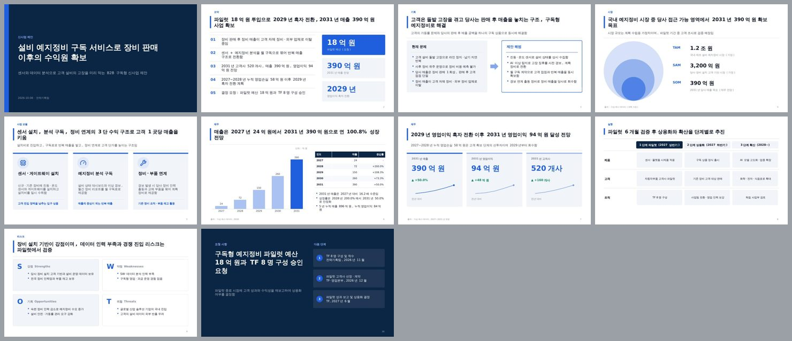

### sales-proposal
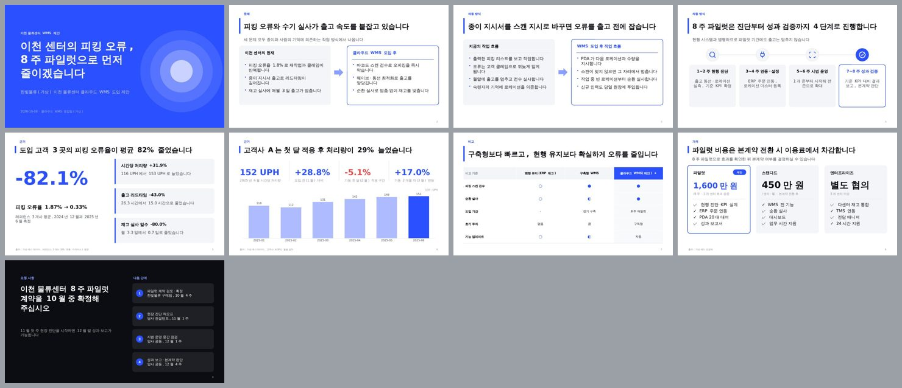

### gov-psst
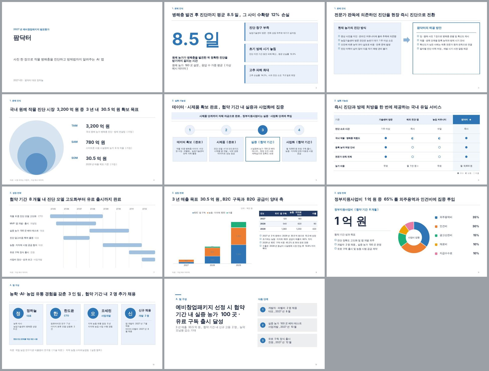

### pitch
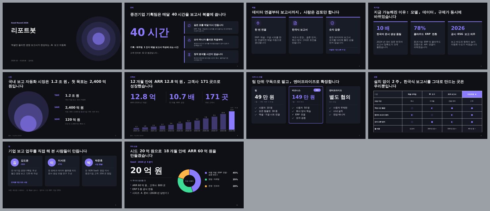

### onboarding-education
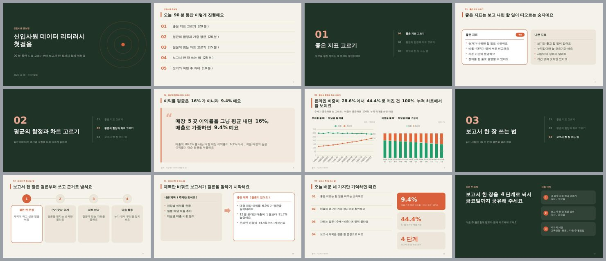

### p1-patterns
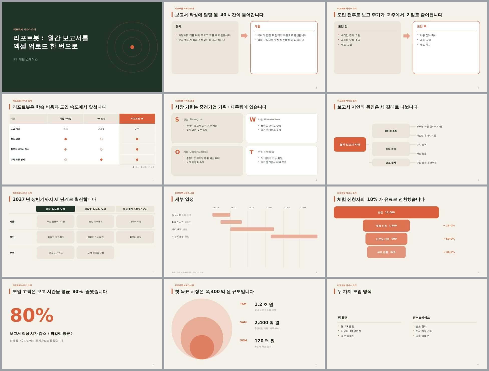

미리보기는 Linux의 LibreOffice와 나눔 글꼴로 렌더링했다. PowerPoint의 맑은 고딕에서는 줄바꿈과 글자 간격이 조금 다를 수 있다.
