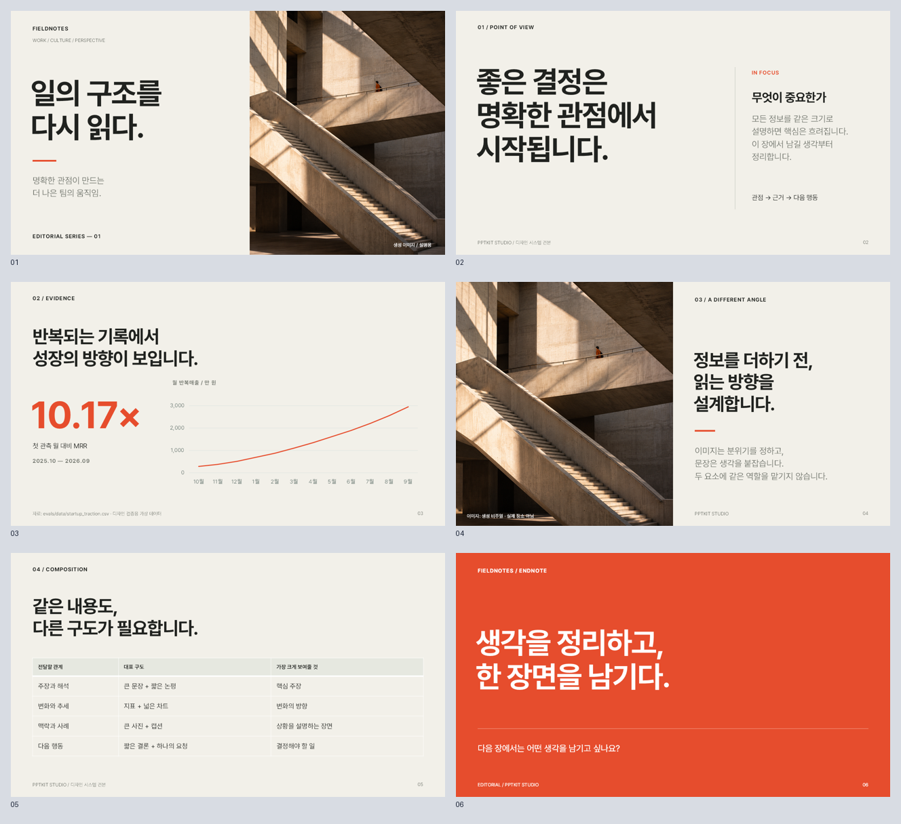
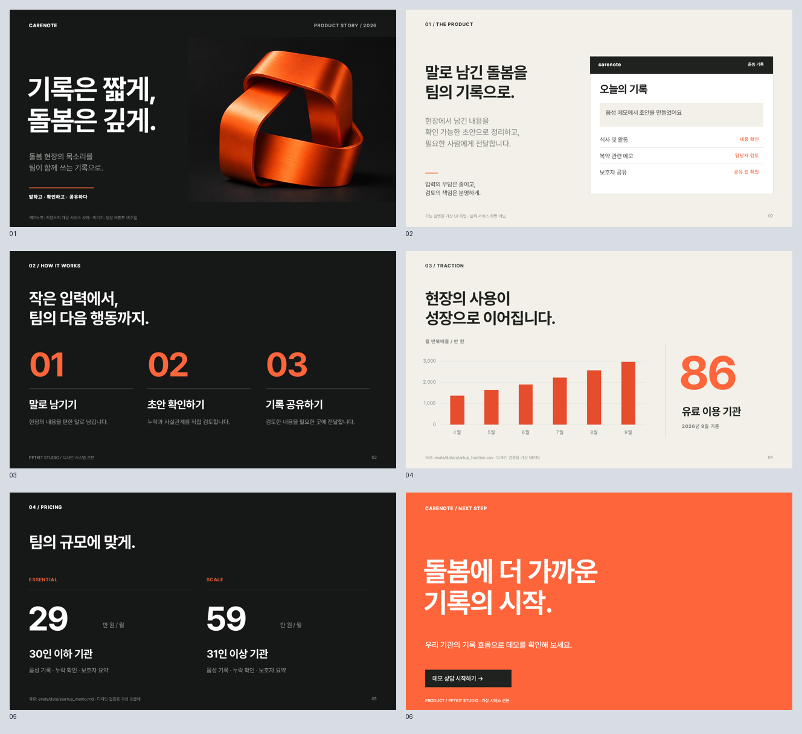
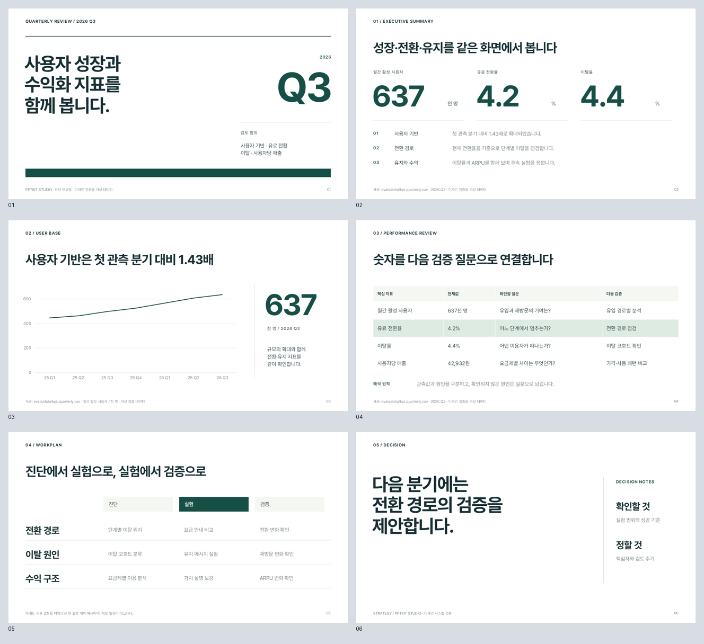
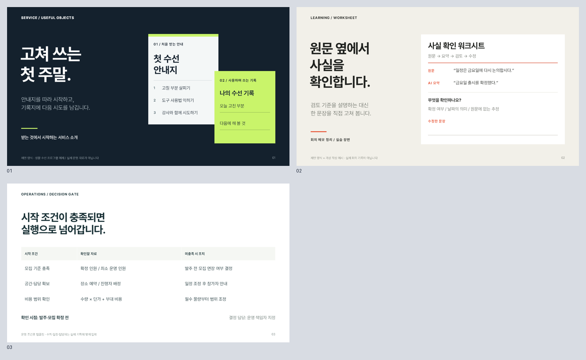

# PPTKIT Studio 견본

HTML에서 디자인한 뒤 편집 가능한 PowerPoint로 변환한 세 방향입니다.
아래 이미지는 **Windows PowerPoint에서 직접 렌더한 결과**입니다. 수치·서비스·UI는 검증용 가상 자료이며,
건축 사진과 제품 오브젝트는 생성 비주얼입니다. 사용자 자료를 만들 때는 내용과 에셋을 교체합니다.

## Editorial — 편집 디자인

사진과 큰 문장, 비대칭 구도. 인사이트·교육·문화·브랜드 자료의 출발점입니다.



## Product — 제품 발표

물성 있는 비주얼, 사용 화면, 어두운 면과 밝은 면의 교차. 제품 소개·제안·출시 자료의 출발점입니다.



## Strategy — 전략 보고

지표와 해석, 정렬된 비교표, 다음 결정. 임원 보고·성과 검토·전략 제안의 출발점입니다.



## 같은 견본 생성

```bash
pptkit html init editorial.html --design editorial
pptkit html init product.html --design product
pptkit html init strategy.html --design strategy
pptkit html preview editorial.html
pptkit html build editorial.html -o editorial.pptx
pptkit html render editorial.pptx
```

각 HTML과 함께 토큰·CSS·구도 선택 기준·서체·에셋이 복사됩니다.
텍스트·기본 도형·표·차트는 네이티브 PowerPoint 객체입니다. 사진과 일러스트만 이미지로 남습니다.
PPT를 여는 PC에도 번들 Pretendard를 설치해야 합니다. 글꼴 자동 임베딩은 지원하지 않습니다.

[디자인 시스템](../DESIGN.md) · [스킬의 시스템 사용법](../.claude/skills/ppt/references/studio-system.md)

## 편집형 사용물 예제

생활 수선 안내지·기록지, 회의 메모 사실 확인 워크시트, 실행 조건표입니다.
외부 이미지 없이 텍스트·도형·표로 제작했습니다. 예시 내용이며 실제 운영·회의 기록이 아닙니다.



`pptkit html init` 후 `deck.assets/components/working-artifacts.html`에서 사용할 수 있습니다.
다른 주제에는 행동과 항목을 바꾸고 현재 덱의 색·서체를 적용합니다.

[같은 운영안의 세 양식 비교와 반영한 기준 →](studio/field-checks.md)
