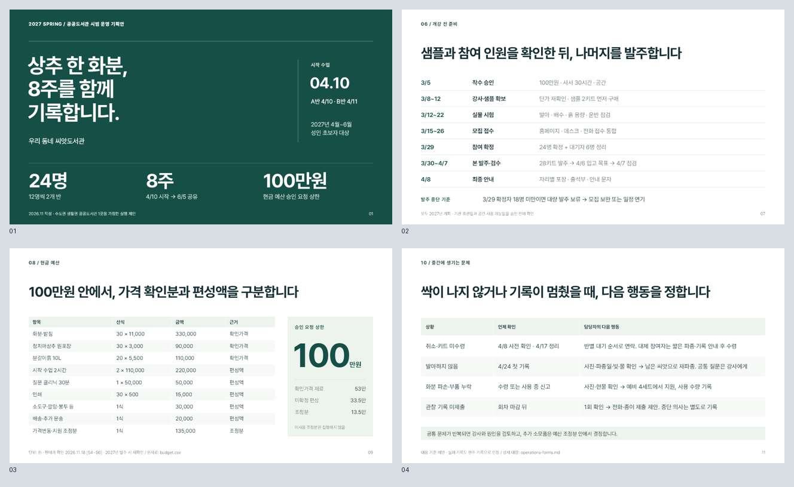
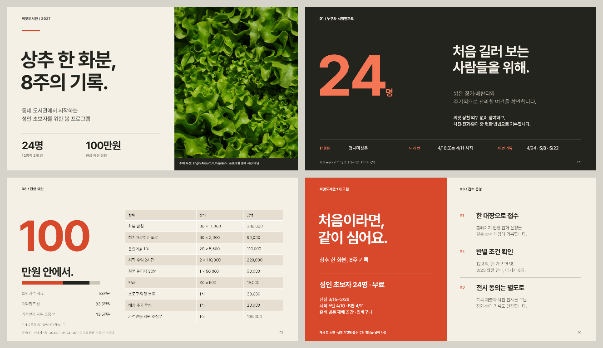
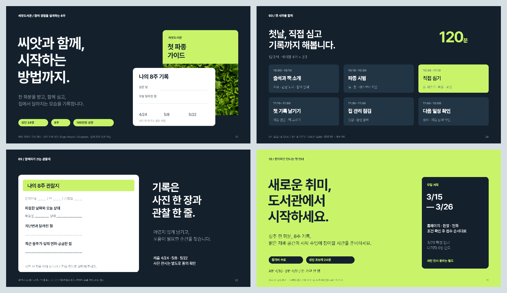

# 같은 운영안, 다른 세 양식

2026-11-18 씨앗도서관 기획을 strategy → editorial → product로 바꾸며 받은 피드백을 기록했다.
특정 기관이 없는 계획안이다. 인원·기간·예산·성과 목표는 실제 사업 실적이 아니다.
아래는 각 14장 덱 중 4장을 고른 **실제 PowerPoint 렌더**다.

| 방향 | 집중한 내용 | 시각적 선택 | 같은 대화의 사용자 반응 |
|---|---|---|---|
| 전략 보고 | 운영 범위·예산·일정·결정 | 정렬된 수치와 표, 작업 흐름 | “나쁘진 않은데” — 다른 양식 요청 |
| 문화 매거진 | 참여 경험과 의미 | 종이색·주황, 사진의 큰 크롭, 대형 숫자·문장 | “좋다” — 다른 양식 추가 요청 |
| 제품·서비스 발표 | 참여자가 받는 안내지·쓰는 관찰지 | 네이비·라임, 편집형 문서, 어두움·밝음의 교차 | “예쁜데?” |

## 전략 보고

프로그램을 운영할 수 있는지 판단하는 데 초점을 맞췄다. 사진보다 정원·자원·기간과 결정 조건이 먼저 읽힌다.

## 문화 매거진

사진·숫자·문장·표의 역할을 나누고 한 장에 보이는 핵심을 줄였다. 동일 운영안을 경험 중심으로 읽게 한다.

## 제품·서비스 발표

안내지와 관찰지는 제안하는 프로그램 양식이다. 이미 배포한 자료나 실제 참가자 기록이 아니다.
이를 대표 비주얼로 사용하면서 참여자가 무엇을 받고 어떻게 쓸지 드러났다.
문서의 문구·면·작성 칸은 PowerPoint에서 편집할 수 있다.

## 스킬에 반영한 것

1. 주제 이름보다 독자가 이해·참여·승인 중 무엇을 할지로 양식을 고른다.
2. 대표 비주얼은 이용자가 받거나 쓰는 것, 또는 주장의 직접적인 근거에서 찾는다.
3. 실행안은 물량·예산·담당·일정·예외를 연결하고, 양식을 바꿔도 기준 자료를 유지한다.
4. 실습지·안내지·기록지는 native text·shape·table로 만들고 실제 문구를 수정해 본다.
5. 표지부터 끝까지 같은 카드를 반복하지 않고 사진·큰 숫자·문장·양식·표의 역할을 나눈다.

기존 견본 18장에 [편집형 사용물 예제 3장](../studio.md#편집형-사용물-예제)을 추가했다.
씨앗·상추·특정 팔레트·14장 분량은 기본값으로 고정하지 않았다.

## 확인 범위

세 덱은 성인 24명, 8주, 30키트, 담당 투입 30시간, 예산안 100만 원이라는 동일 기준 자료를 사용했다.
이 값은 사례의 편성 가정이다. 새 기획에 그대로 적용할 기준이 아니다.
사진이나 숫자로 실제 참여·재배·성과가 있었다고 주장하지 않는다.

같은 사용자와 이어진 디자인 개선 대화의 선호 기록이다. 이 결과만으로 다른 사용자·새 대화에서도
같은 품질이 나온다고 단정하지 않는다. [전이 평가 시나리오](../../evals/html-first.json)에는 다른 주제와
사용물 비주얼이 불필요한 데이터 보고도 포함했다. 시나리오 파일은 자동으로 평가를 실행하지 않는다.

## 이미지 출처

이 세 미리보기와 출처·가정 기록은 `pptkit html init`의 `deck.assets/showcase/`에도 포함된다.
시각 참고용이며 새 PPT의 장표 이미지로 삽입하는 용도가 아니다.

편집형·제품형 미리보기의 상추 주제 사진은 [Engin Akyurt / Unsplash](https://unsplash.com/photos/a-close-up-of-a-green-leafy-plant-6djmntSYfoE),
[Unsplash License](https://unsplash.com/license)를 따른다. 기존 제작에서 2026-11-18 확인한 사진이다.
프로그램의 실제 수확이나 특정 품종을 증명하지 않는다. 이 공개용 발췌에는 판매자 상품 사진을 포함하지 않았다.

## 추가 예제 검증

2026-11-18: 새 편집형 사용물 예제 3장의 HTML과 PowerPoint 렌더를 비교했다.
텍스트 39개·도형 12개·표 1개·이미지 0개, 텍스트 보존 검사와 PowerPoint COM 검사를 통과했다.
안내 문구와 표 셀을 수정하고 다시 저장하는 테스트를 포함해 HTML 관련 14개, 기존 기능 26개가 통과했다.
스킬 형식과 참조 링크, 배포 wheel에 새 문서·컴포넌트가 들어가는지도 확인했다.
자동 검사는 표현 품질의 증명이 아니며, 새 주제 전체 덱에 대한 독립 평가는 아직 실행하지 않았다.
